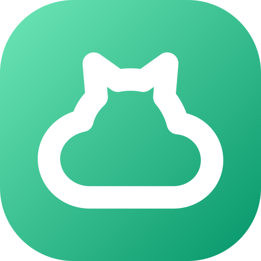

  

# Verhaltenskodex für MoeCloud

## Unser Versprechen

Im Interesse einer offenen und freundlichen Umgebung verpflichten wir uns als Beitragende und Betreuende dazu, die Teilnahme an unserem Projekt und unserer Community für alle frei von Belästigung zu halten, unabhängig von Alter, Körpergröße, Behinderung, Ethnizität, Geschlechtsmerkmalen, Geschlechtsidentität und -ausdruck, Erfahrungsniveau, Bildung, sozioökonomischem Status, Nationalität, persönlichem Erscheinungsbild, Religion oder sexueller Identität und Orientierung.

## Unsere Standards

Beispiele für Verhalten, das zu einer positiven Umgebung beiträgt:

- Empathie und Freundlichkeit gegenüber anderen Menschen zeigen
- Unterschiedliche Meinungen, Standpunkte und Erfahrungen respektieren
- Konstruktives Feedback geben und annehmen
- Verantwortung übernehmen, sich bei denen entschuldigen, die von unseren Fehlern betroffen sind, und aus der Erfahrung lernen
- Sich auf das konzentrieren, was nicht nur für uns als Einzelne, sondern für die ganze Community am besten ist

Beispiele für inakzeptables Verhalten:

- Sexualisierte Sprache oder Bilder und sexuelle Aufmerksamkeit oder Annäherungsversuche jeder Art
- Trollen, beleidigende oder herabsetzende Kommentare und persönliche oder politische Angriffe
- Öffentliche oder private Belästigung
- Das Veröffentlichen privater Informationen anderer, etwa Post- oder E-Mail-Adressen, ohne deren ausdrückliche Erlaubnis
- Anderes Verhalten, das in einem professionellen Umfeld als unangemessen gelten würde

## Unsere Verantwortung

Die Betreuenden des Projekts legen fest, was als akzeptables Verhalten gilt, setzen es durch und reagieren angemessen und fair auf jedes Verhalten, das sie als unangemessen, bedrohlich, beleidigend oder schädlich ansehen.

Sie haben das Recht und die Verantwortung, Kommentare, Commits, Code, Wiki-Änderungen, Issues und andere Beiträge zu entfernen, zu bearbeiten oder abzulehnen, die nicht zu diesem Verhaltenskodex passen, und erklären ihre Entscheidungen, wenn es angemessen ist.

## Geltungsbereich

Dieser Verhaltenskodex gilt in allen Räumen der Community und auch dann, wenn eine Person die Community in der Öffentlichkeit offiziell vertritt, etwa mit einer offiziellen E-Mail-Adresse, über ein offizielles Social-Media-Konto oder als benannte Vertretung bei einer Veranstaltung online oder vor Ort.

## Durchsetzung

Missbräuchliches, belästigendes oder anderweitig inakzeptables Verhalten kannst du über das [Kontaktformular](https://mm-s.gg) melden. Jede Meldung wird zügig und fair geprüft.

Alle, die den Verhaltenskodex durchsetzen, respektieren die Privatsphäre und Sicherheit der Person, die einen Vorfall meldet.

## Richtlinien für die Durchsetzung

Bei Verstößen gegen diesen Verhaltenskodex richten sich die Folgen nach diesen Stufen:

### 1. Korrektur

**Auswirkung auf die Community**: Unangemessene Sprache oder anderes Verhalten, das als unprofessionell oder unerwünscht gilt.

**Folge**: Eine private, schriftliche Warnung, die den Verstoß benennt und erklärt, warum das Verhalten unangemessen war. Eine öffentliche Entschuldigung kann verlangt werden.

### 2. Warnung

**Auswirkung auf die Community**: Ein Verstoß durch einen einzelnen Vorfall oder eine Reihe von Handlungen.

**Folge**: Eine Warnung mit Folgen für den Fall, dass das Verhalten anhält. Für einen festgelegten Zeitraum gibt es keinen Kontakt mit den beteiligten Personen, auch nicht unaufgefordert mit denen, die den Verhaltenskodex durchsetzen. Das gilt in Räumen der Community und in externen Kanälen wie Social Media. Wer sich nicht daran hält, kann vorübergehend oder dauerhaft ausgeschlossen werden.

### 3. Vorübergehender Ausschluss

**Auswirkung auf die Community**: Ein schwerer Verstoß gegen die Standards der Community, auch anhaltend unangemessenes Verhalten.

**Folge**: Ein vorübergehender Ausschluss von jeder Art von Austausch oder öffentlicher Kommunikation mit der Community für einen festgelegten Zeitraum. In dieser Zeit ist kein öffentlicher oder privater Kontakt mit den beteiligten Personen erlaubt, auch nicht unaufgefordert mit denen, die den Verhaltenskodex durchsetzen. Wer sich nicht daran hält, kann dauerhaft ausgeschlossen werden.

### 4. Dauerhafter Ausschluss

**Auswirkung auf die Community**: Ein Muster von Verstößen gegen die Standards der Community, etwa anhaltend unangemessenes Verhalten, die Belästigung einer Person oder Aggression gegenüber Gruppen von Menschen oder deren Herabsetzung.

**Folge**: Ein dauerhafter Ausschluss von jeder Art von öffentlichem Austausch in der Community.

## Herkunft

Dieser Verhaltenskodex ist eine Bearbeitung des [Contributor Covenant](https://www.contributor-covenant.org/) in den Versionen [1.4](https://www.contributor-covenant.org/version/1/4/code-of-conduct/) und [2.0](https://www.contributor-covenant.org/version/2/0/code_of_conduct/) und entstand mit [contributing-gen](https://github.com/bttger/contributing-gen).
