<div align="center">
  <a href="https://moecloud.moestudio.net"></a>
  <h1>MoeCloud</h1>
  <p>Deine Dateien, dein Server: hochladen, ansehen, teilen und als Laufwerk einbinden.</p>

![GitHub Lizenz]
![GitHub Letzte Änderung]
[![Docker-Image]](https://github.com/MaximilianGT500/moecloud/pkgs/container/moecloud)
![GitHub Issues]
![GitHub Sterne]

</div>

[GitHub Lizenz]: https://img.shields.io/github/license/MaximilianGT500/moecloud?color=059669&style=for-the-badge
[GitHub Letzte Änderung]: https://img.shields.io/github/last-commit/MaximilianGT500/moecloud?color=059669&label=Letzte%20%C3%84nderung&style=for-the-badge
[Docker-Image]: https://img.shields.io/badge/Docker-ghcr.io-059669?style=for-the-badge&logo=docker&logoColor=white
[GitHub Issues]: https://img.shields.io/github/issues/MaximilianGT500/moecloud?color=059669&label=Issues&style=for-the-badge
[GitHub Sterne]: https://img.shields.io/github/stars/MaximilianGT500/moecloud?color=059669&label=Sterne&style=for-the-badge

MoeCloud ist eine Cloud für deine Dateien, die du selbst betreibst, als schlanke Alternative zu Nextcloud und Google Drive. Du lädst Dateien und ganze Ordner im Browser hoch, siehst dir Bilder, Videos, PDFs, Markdown, Code, Tabellen und Office-Dokumente direkt an und teilst Ordner mit anderen Konten oder über einen Link, auf Wunsch mit Passwort und Ablaufdatum. Fotos sortiert MoeCloud nach Aufnahmedatum, mit [ClamAV](https://www.clamav.net) prüft es jeden Upload auf Schadsoftware, und per WebDAV bindest du alles als Laufwerk ein. MoeCloud läuft in einem Container mit SQLite, deine Dateien liegen in einem Ordner auf deinem Server. Eingerichtet wird im Browser: Beim ersten Start führt dich ein Assistent durch Name, Adresse, Farben und Admin-Konto, eine `.env` brauchst du nicht.

Mehr zum Projekt und eine Kurzanleitung gibt es auf [moecloud.moestudio.net](https://moecloud.moestudio.net). Was sich in jeder Version geändert hat, steht im [Changelog](CHANGELOG.md).

<p align="center">
  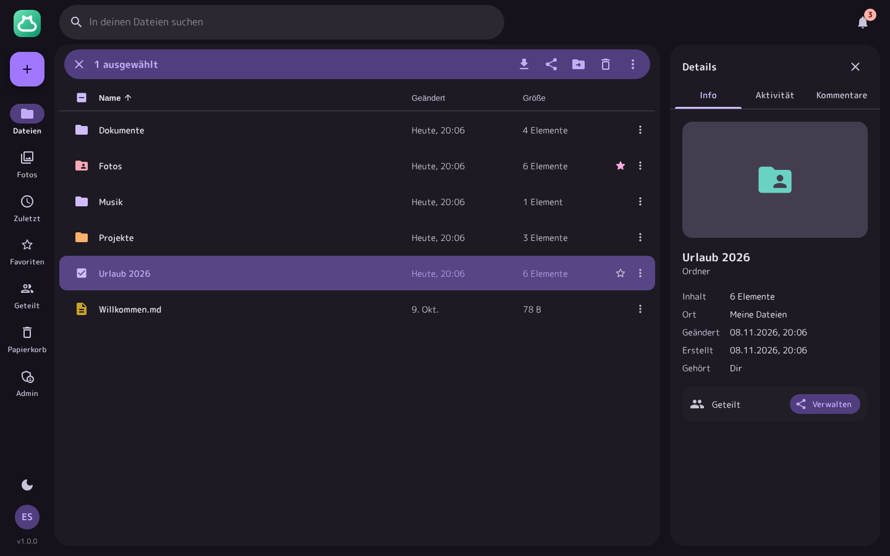
</p>
<p align="center">
  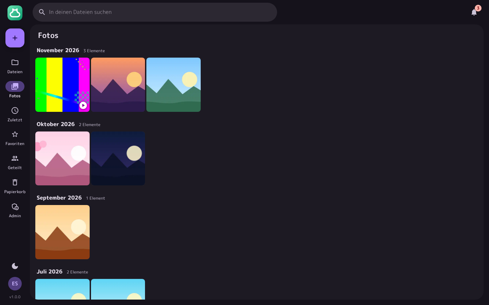
  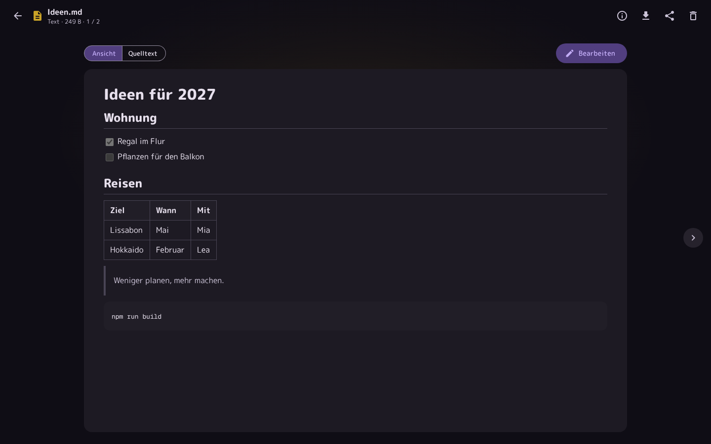
</p>
<p align="center">
  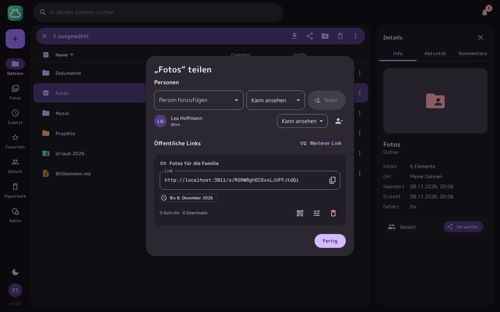
  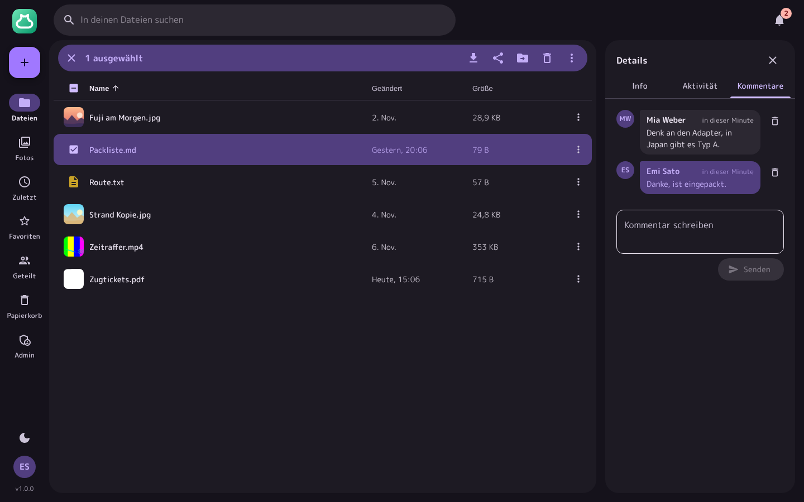
</p>

## Inhalt

- [Funktionen](#funktionen)
- [Installation](#installation)
- [Erster Start und Einrichtung](#erster-start-und-einrichtung)
- [Dateien](#dateien)
- [Vorschau](#vorschau)
- [Fotos](#fotos)
- [Teilen](#teilen)
- [Kommentare, Aktivität und Benachrichtigungen](#kommentare-aktivität-und-benachrichtigungen)
- [Als Laufwerk einbinden](#als-laufwerk-einbinden)
- [Konto und Sicherheit](#konto-und-sicherheit)
- [Verwaltung](#verwaltung)
- [Virenscan mit ClamAV](#virenscan-mit-clamav)
- [E-Mail](#e-mail)
- [Webhooks](#webhooks)
- [Einstellungen und Umgebungsvariablen](#einstellungen-und-umgebungsvariablen)
- [Metriken für Prometheus](#metriken-für-prometheus)
- [Versionsprüfung](#versionsprüfung)
- [Updates](#updates)
- [Datensicherung](#datensicherung)
- [Kommandozeile](#kommandozeile)
- [API](#api)
- [Entwicklung](#entwicklung)
- [Support, Mitwirken und Lizenz](#support-mitwirken-und-lizenz)

## Funktionen

- **Hochladen** per Drag & Drop oder über „Neu“, einzelne Dateien und ganze Ordner samt Unterordnern
- **Große Dateien** gehen in Teilen von 16 MB hoch. Bricht die Verbindung ab, setzt der Upload an derselben Stelle wieder an
- **Vorschau** für Bilder, Videos, Audio, PDFs, Markdown, Code mit Hervorhebung, CSV, JSON, Word, Excel, ZIP-Archive und Schriften. Textdateien bearbeitest du direkt im Browser
- **Vorschaubilder** für Fotos, Videos, PDFs und Musik mit Cover
- **Fotos** zeigt alle Bilder und Videos nach Aufnahmedatum, die Bildansicht Kamera, Objektiv und Belichtung, dazu eine Diashow
- **Volltextsuche** in Texten, PDFs und Office-Dokumenten, mit Filtern für Ordner, Bilder, Videos, Audio, PDFs und Dokumente
- **Ordnerfarben**, Favoriten, Zuletzt und ein Papierkorb, aus dem Gelöschtes 30 Tage lang zurückkommt
- **Versionen**: Ersetzt du eine Datei oder speicherst einen Text, bleibt die alte Fassung erhalten und lässt sich zurückholen
- **Speicher** zeigt, was wie viel Platz belegt, die größten und die doppelten Dateien
- **Grenzen** für den Speicher pro Person und die Größe einzelner Dateien, mit Hinweis, wenn der Speicher fast voll ist
- **Teilen mit Personen**: Ordner und Dateien für andere Konten freigeben, zum Ansehen oder zum Bearbeiten
- **Öffentliche Links** mit Bezeichnung, Passwort, Ablaufdatum, QR-Code und Zählern für Aufrufe und Downloads, Ordner gibt es als ZIP
- **Dateien anfragen**: Ein Link nur zum Hochladen sammelt Dateien von anderen ein, auf Wunsch mit Benachrichtigung
- **Kommentare und Aktivität** an jeder Datei und jedem Ordner, dazu Benachrichtigungen in der App und per E-Mail
- **Virenscan** mit ClamAV für alle Uploads, mit gesperrten Dateien und erneuter Prüfung
- **WebDAV** zum Einbinden als Laufwerk, mit eigenen App-Passwörtern pro Gerät
- **Live**: Änderungen erscheinen sofort auf allen Geräten, auf denen MoeCloud offen ist
- **Sparsamer Speicher**: Gleiche Dateien liegen nur einmal auf der Platte, auch wenn sie mehrfach hochgeladen werden
- **Anmeldung** mit Passwort, Authenticator-App samt Wiederherstellungscodes oder Passkey, „Passwort vergessen“ per E-Mail und ein Protokoll aller Anmeldungen
- **Verwaltung** im Browser: Übersicht mit Zustand, Personen, Einladungen per E-Mail, alle Links, Protokoll, Virenscan, E-Mail, Webhooks, Sicherungen, Wartungsmodus und Hinweise für alle
- **Für den Dauerbetrieb**: nächtliche Sicherungen der Datenbank, Versionsprüfung, Metriken für Prometheus, Health-Check und Logs als Text oder JSON
- **Material You** mit Farben aus einer Grundfarbe, dunkel als Standard, mit hellem Design, mehr Kontrast, echtem Schwarz und wählbaren Ecken
- **Auf dem Handy** mit eigener Navigation am unteren Rand
- **Deutsch und Englisch**, jede Person wählt ihre Sprache selbst

## Installation

Am schnellsten geht es mit dem [Installationsskript](#mit-dem-installationsskript). Von Hand brauchst du Docker oder **Node.js 24 oder neuer**.

### Mit dem Installationsskript

Auf einem Linux-Server richtet ein Skript alles ein: Docker (falls es fehlt, über das offizielle Skript von get.docker.com), die Dateien von MoeCloud in `/opt/moecloud`, auf Wunsch Caddy für HTTPS und ClamAV als Virenscan.

```bash
curl -fsSL https://moecloud.moestudio.net/install.sh | sudo bash
```

Das Skript fragt nach Domain und ClamAV und zeigt am Ende den Link zum Einrichtungsassistenten. Ohne Rückfragen geht es mit Optionen:

```bash
curl -fsSL https://moecloud.moestudio.net/install.sh | sudo bash -s -- --domain cloud.example.com --clamav --yes
```

| Option          | Bedeutung                                        |
| --------------- | ------------------------------------------------ |
| `--domain NAME` | Domain für HTTPS über Caddy                      |
| `--clamav`      | ClamAV als Virenscan mitstarten                  |
| `--no-clamav`   | ClamAV nicht einrichten                          |
| `--port ZAHL`   | Port auf dem Server ohne Domain, Standard `3000` |
| `--dir PFAD`    | Installationsordner, Standard `/opt/moecloud`    |
| `--update`      | Eine bestehende Installation aktualisieren       |
| `--yes`         | Keine Rückfragen, Standardwerte nehmen           |

Mit Domain bindet das Skript MoeCloud nur an `127.0.0.1`, erreichbar ist es dann ausschließlich über Caddy. Außerdem legt es den Befehl `moecloud` an:

| Befehl                  | Zweck                                                                   |
| ----------------------- | ----------------------------------------------------------------------- |
| `sudo moecloud update`  | Auf die neueste Version aktualisieren                                   |
| `sudo moecloud logs`    | Logs ansehen                                                            |
| `sudo moecloud restart` | MoeCloud neu starten                                                    |
| `sudo moecloud stop`    | MoeCloud und alle Dienste daneben beenden, `start` startet sie wieder   |
| `sudo moecloud …`       | Alle anderen Befehle der [Kommandozeile](#kommandozeile), etwa `backup` |

Das Skript liegt auch im Repository unter [`website/install.sh`](website/install.sh). Wer es vorher lesen möchte, lädt es erst herunter und startet es dann mit `sudo bash install.sh`.

### Mit Docker

Das Image liegt in der GitHub Container Registry unter `ghcr.io/maximiliangt500/moecloud` und läuft auf `amd64` und `arm64`, also auch auf dem Raspberry Pi. Für den Start reicht die [`docker-compose.yml`](docker-compose.yml):

```bash
mkdir moecloud && cd moecloud
curl -O https://raw.githubusercontent.com/MaximilianGT500/moecloud/main/docker-compose.yml
docker compose up -d
docker compose logs -f moecloud
```

In den Logs erscheint der Link zur Einrichtung. Alle Daten landen im Ordner `data/` neben der `docker-compose.yml`. Eine Vorlage für die `.env` mit allen Variablen liegt als [`.env.example`](.env.example) im Repository.

Was der Stack mitbringt:

- **Eigener Benutzer**: MoeCloud läuft im Container nicht als root. Beim Start bekommt `data/` den Besitzer aus `PUID` und `PGID` (Standard `1000`). Soll der Ordner auf dem Host einem anderen Benutzer gehören, trägst du beide in die `.env` ein.
- **Vorschauen**: ffmpeg und Poppler für Vorschaubilder von Videos und PDFs sind im Image schon dabei.
- **Abgesichert**: schreibgeschütztes Dateisystem bis auf `data/` und `/tmp`, keine zusätzlichen Rechte (`no-new-privileges`, nur die nötigen Capabilities).
- **Health-Check** über `/healthz`, Docker zeigt den Zustand mit `docker compose ps`.
- **Logs** mit Rotation (3 × 10 MB) und Zeitzone aus `TZ`.
- **Sauberes Beenden**: laufende Anfragen dürfen bis zu 20 Sekunden fertig werden.

Zu jeder veröffentlichten Version gibt es neben `latest` eigene Tags wie `1.0.0`, `1.0` und `1`. Selbst bauen geht mit `docker build -t ghcr.io/maximiliangt500/moecloud:latest .` im geklonten Repository, `docker compose up -d` nimmt dann dieses Image.

### ClamAV dazunehmen

Die Ergänzung [`docker/clamav.yml`](docker/clamav.yml) startet ClamAV als eigenen Container und verbindet MoeCloud damit:

```bash
mkdir -p docker
curl -o docker/clamav.yml https://raw.githubusercontent.com/MaximilianGT500/moecloud/main/docker/clamav.yml
echo "COMPOSE_FILE=docker-compose.yml:docker/clamav.yml" >> .env
docker compose up -d
```

Beim ersten Start lädt ClamAV seine Signaturen, das dauert ein paar Minuten. Der Container braucht etwa 3 GB Arbeitsspeicher. Mehr dazu unter [Virenscan mit ClamAV](#virenscan-mit-clamav).

### Mit eigener Domain und HTTPS

Für den Betrieb im Internet gehört MoeCloud hinter einen Reverse-Proxy mit HTTPS. Passkeys funktionieren nur über HTTPS oder `localhost`, und Windows bindet WebDAV nur über HTTPS ohne Umwege ein.

Die `docker-compose.yml` bringt dafür Caddy mit, das Zertifikate selbst holt. Caddy braucht die [`Caddyfile`](docker/Caddyfile) im Ordner `docker/`:

```bash
mkdir -p docker
curl -o docker/Caddyfile https://raw.githubusercontent.com/MaximilianGT500/moecloud/main/docker/Caddyfile
echo "DOMAIN=cloud.example.com" >> .env
echo "COMPOSE_PROFILES=caddy" >> .env
echo "MOECLOUD_BIND=127.0.0.1" >> .env
docker compose up -d
```

Durch `COMPOSE_PROFILES` startet `docker compose` Caddy bei jedem `up` mit, `MOECLOUD_BIND` sorgt dafür, dass Port 3000 nur noch auf dem Server selbst erreichbar ist. Die Domain muss auf deinen Server zeigen und die Ports 80 und 443 müssen frei sein. Ist MoeCloud noch nicht eingerichtet, öffnest du den Link aus dem Log gleich unter deiner Domain, also `https://cloud.example.com/setup?code=…`.

Lief Caddy schon einmal ohne die Caddyfile, hat Docker an ihrer Stelle einen leeren Ordner `docker/Caddyfile` angelegt, und Caddy startet nicht. Entferne ihn vor dem Download mit `sudo rmdir docker/Caddyfile`.

Ohne Docker reicht in Caddy:

```
cloud.example.com {
	reverse_proxy localhost:3000 {
		flush_interval -1
	}
}
```

Mit nginx brauchst du zusätzlich unbegrenzte Anfragegrößen für Uploads und WebDAV und eine ungepufferte Verbindung, damit Änderungen live ankommen:

```nginx
server {
  server_name cloud.example.com;
  client_max_body_size 0;

  location / {
    proxy_pass http://127.0.0.1:3000;
    proxy_set_header Host $host;
    proxy_set_header X-Forwarded-For $proxy_add_x_forwarded_for;
    proxy_set_header X-Forwarded-Proto $scheme;
    proxy_buffering off;
    proxy_request_buffering off;
  }
}
```

MoeCloud glaubt den Angaben in `X-Forwarded-For` und `X-Forwarded-Proto` nur von Proxys auf demselben Rechner oder im lokalen Netz. Steht dein Proxy woanders, stellst du das mit `TRUST_PROXY` ein.

### Mit Node.js

Du brauchst Node.js 24 oder neuer. Für Vorschaubilder von Videos und PDFs und die Suche in PDFs installierst du zusätzlich ffmpeg und Poppler, unter Debian und Ubuntu etwa mit `apt install ffmpeg poppler-utils`. Ohne sie läuft MoeCloud trotzdem, nur mit weniger Vorschauen. Welche Programme gefunden wurden, zeigt **Admin › System**.

```bash
git clone https://github.com/MaximilianGT500/moecloud.git
cd moecloud
npm ci
npm run build
npm start
```

Die Daten liegen dann im Ordner `data/` im Projekt, mit `DATA_DIR` legst du sie woanders hin. Für den Dauerbetrieb eignet sich ein systemd-Dienst oder [PM2](https://pm2.keymetrics.io/) mit `pm2 start npm --name moecloud -- start`. MoeCloud läuft als ein einzelner Prozess, einen Cluster-Modus gibt es nicht.

## Erster Start und Einrichtung

Solange es noch kein Konto gibt, schreibt MoeCloud bei jedem Start einen Link mit Einrichtungscode ins Log:

```
MoeCloud ist noch nicht eingerichtet. Öffne http://localhost:3000/setup?code=… im Browser.
```

Läuft MoeCloud auf einem anderen Rechner oder hinter einer Domain, ersetzt du `http://localhost:3000` durch die passende Adresse oder setzt vorher `PUBLIC_URL`. Nur wer den Code kennt, kann die Einrichtung abschließen. Der Code bleibt auch nach einem Neustart gleich, einen neuen erzeugst du mit `setup-link --new`, siehe [Kommandozeile](#kommandozeile).

<p align="center">
  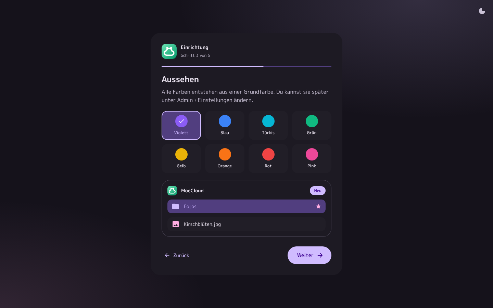
</p>

Der Assistent führt in 5 Schritten durch:

1. **Einrichtungscode** und Sprache
2. **Deine Cloud**: Name und Adresse, unter der andere sie erreichen
3. **Aussehen**: eine von 8 Grundfarben oder eine eigene, mit Vorschau
4. **Dein Konto**: Name, Benutzername, E-Mail und Passwort für das erste Admin-Konto
5. **Regeln**: wer sich registrieren darf und wie viel Speicher jede Person bekommt

Danach bist du angemeldet und landest in deinen Dateien. Alles lässt sich später unter **Admin › Einstellungen** ändern. Als Nächstes lohnt sich der [E-Mail-Versand](#e-mail), damit „Passwort vergessen“ funktioniert, und bei geteilten Ordnern der [Virenscan](#virenscan-mit-clamav).

## Dateien

Unter **Dateien** liegen deine Ordner und Dateien, als Liste oder als Kacheln mit Vorschaubildern. Daneben zeigt der Detailbereich in drei Reitern **Info** mit Größe, Ort, Änderungsdatum, Bildinfos, Ergebnis des Virenscans, Freigaben und Versionen, die **Aktivität** und die **Kommentare**.

- **Hochladen**: Zieh Dateien oder Ordner ins Fenster oder direkt auf einen Ordner, oder nimm **Neu › Dateien hochladen** und **Neu › Ordner hochladen**. Gibt es eine Datei schon, wählst du zwischen „Beide behalten“ und „Ersetzen“. Beim Ersetzen bleibt die alte Fassung als Version erhalten.
- **Neue Textdatei** und **Neuer Ordner** findest du ebenfalls unter **Neu**.
- **Ordnen**: Zieh Elemente auf einen Ordner oder in die Pfadleiste, oder verschieben und kopieren über das Menü. Mehrere wählst du mit Strg, ⌘ oder Umschalt aus.
- **Ordnerfarben**: Im Menü eines Ordners gibt **Farbe** ihm eine von zehn Farben, auch für mehrere Ordner auf einmal.
- **Herunterladen**: Dateien einzeln, Ordner und mehrere Elemente als ZIP. Unter **Konto** lädst du alle eigenen Dateien als ein ZIP herunter.
- **Zuletzt** zeigt, was du zuletzt hochgeladen oder geändert hast, daneben die **Aktivität** in all deinen Ordnern. **Favoriten** sammelt alles mit Stern.
- **Suche**: Die Suchleiste findet Dateien und Ordner nach Namen und Wörter im Inhalt von Texten, PDFs und Office-Dokumenten. Filter grenzen auf Ordner, Bilder, Videos, Audio, PDFs oder Dokumente ein, Treffer im Inhalt erscheinen mit der passenden Stelle.
- **Speicher** zeigt, was wie viel Platz belegt, die größten Dateien und Dateien mit genau gleichem Inhalt. Du erreichst die Seite über dein Bild unten links und unter **Konto**. Ist dein Speicher zu 90 % voll, bekommst du eine Benachrichtigung.
- **Papierkorb**: Gelöschtes bleibt dort 30 Tage, danach räumt MoeCloud es weg. Ordner kommen samt Inhalt zurück. Die Frist stellst du unter **Admin › Einstellungen › Speicher** ein.

<p align="center">
  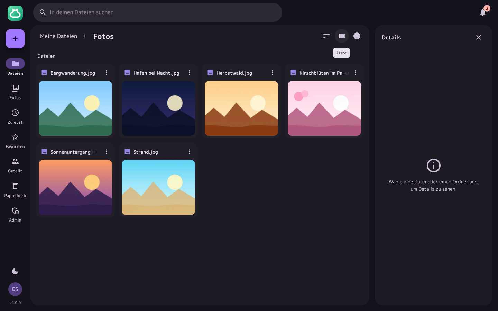
  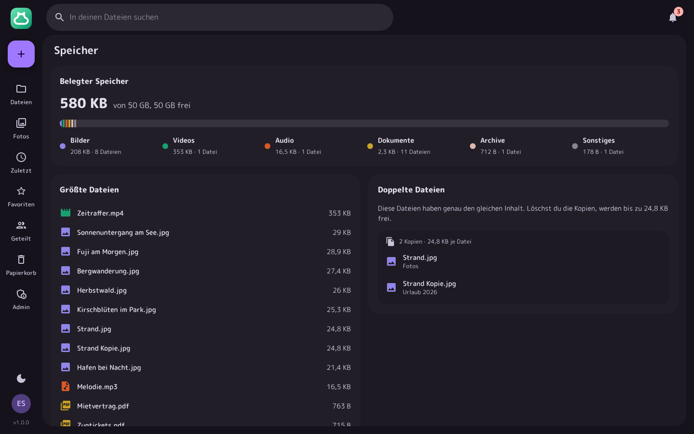
</p>

Mit der Tastatur:

| Taste                   | Wirkung                         |
| ----------------------- | ------------------------------- |
| `/`                     | Suche öffnen                    |
| Pfeiltasten, Pos1, Ende | Zwischen den Elementen wechseln |
| Enter                   | Öffnen                          |
| Leertaste               | Auswählen                       |
| Strg+A                  | Alles auswählen                 |
| Entf                    | In den Papierkorb               |
| F2                      | Umbenennen                      |
| Esc                     | Auswahl aufheben                |
| Umschalt+F10            | Menü des Elements               |

Auf dem Handy wechselst du am unteren Rand zwischen Dateien, Fotos, Zuletzt, Geteilt und deinem Konto, Favoriten, Aktivität, Speicher und Papierkorb liegen oben in deinen Dateien. Ein Tipp öffnet, langes Drücken wählt aus.

<p align="center">
  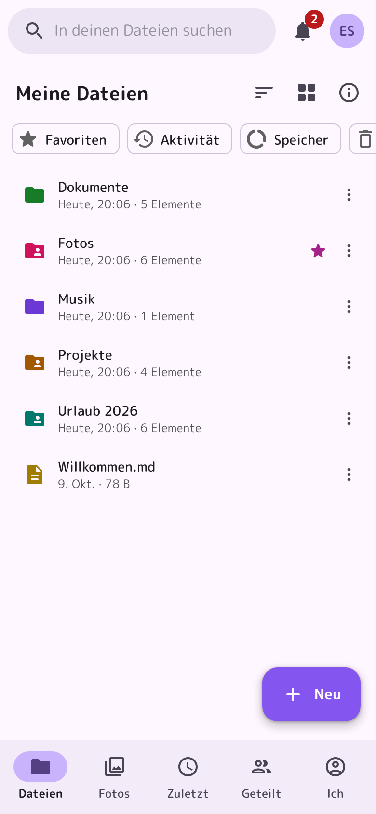
  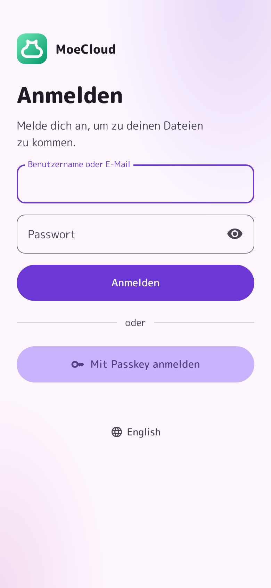
</p>

## Vorschau

Ein Doppelklick öffnet eine Datei in der Vollbildansicht, mit den Pfeiltasten oder einem Wischen geht es zur nächsten. Die Taste `i` blendet die Informationen zur Datei ein.

| Art              | Vorschau                                                                                              |
| ---------------- | ----------------------------------------------------------------------------------------------------- |
| Bilder           | Zoomen mit Mausrad oder Doppelklick, Kamera, Objektiv, Belichtung und Aufnahmedatum, Diashow          |
| Videos und Audio | Player, bei Musik mit Cover, Titel, Interpret und Album                                               |
| PDFs             | Im Browser mit allen Seiten                                                                           |
| Markdown         | Gesetzt mit Überschriften, Tabellen und Aufgabenlisten, auf Wunsch als Quelltext                      |
| Code und Texte   | Hervorhebung für mehr als 30 Sprachen und Zeilennummern, bis 2 MB bearbeiten und mit Strg+S speichern |
| CSV, JSON        | CSV als Tabelle, JSON eingerückt und hervorgehoben                                                    |
| Word und Excel   | Word-Dokumente mit Seiten, Excel-Tabellen mit allen Blättern                                          |
| ZIP-Archive      | Inhalt mit Größen und Datum, durchsuchbar, einzelne Dateien daraus herunterladen                      |
| Schriften        | TTF, OTF, WOFF und WOFF2 mit eigenem Beispieltext                                                     |

Vorschaubilder erzeugt MoeCloud im Hintergrund, für Videos mit ffmpeg, für PDFs mit Poppler und für Musik aus dem eingebetteten Cover. Dabei liest es auch Bildinfos, Musik-Tags und den Text für die Suche aus. Für Dateien, die schon vor dem Update da waren, holt MoeCloud das nach dem Start selbst nach. Dateien, in denen der Virenscan etwas gefunden hat, öffnet die Vorschau nicht.

<p align="center">
  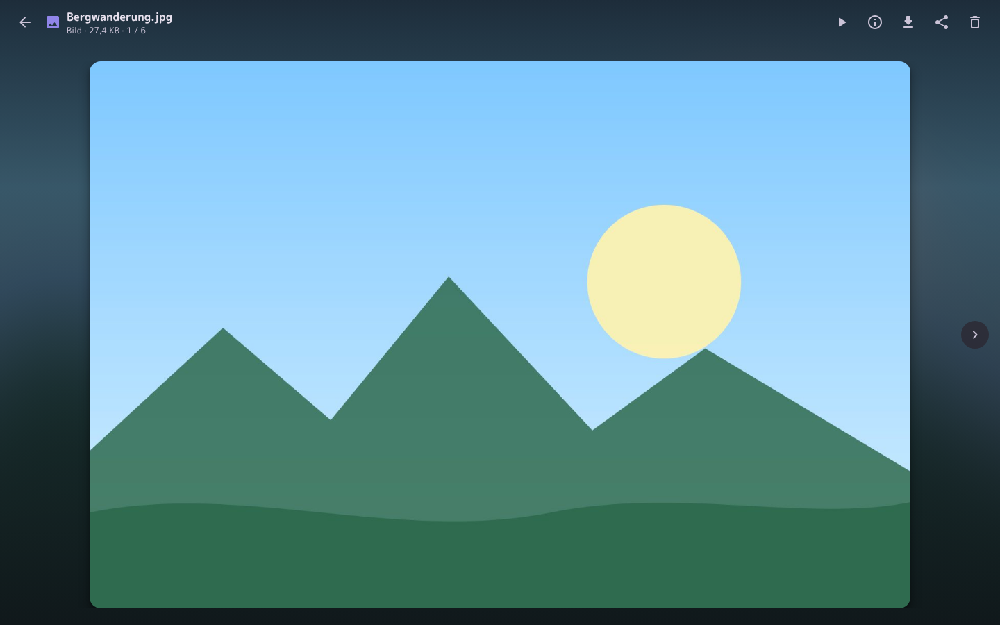
</p>

## Fotos

**Fotos** zeigt alle Bilder und Videos aus deinen Ordnern, nach Monaten gruppiert und sortiert nach dem Aufnahmedatum aus den EXIF-Daten. Fehlt es, zählt das Änderungsdatum. Ein Klick öffnet die Bildansicht, ▶ startet dort eine Diashow mit allen Bildern.

## Teilen

Über **Teilen** im Menü eines Elements gibst du Ordner und Dateien frei. Unter **Geteilt** siehst du, was andere mit dir teilen und was du selbst teilst.

**Mit Personen**: Du suchst ein Konto nach Name oder Benutzername und wählst „Kann ansehen“ oder „Kann bearbeiten“. Bei der anderen Person erscheint die Freigabe unter **Geteilt**, dazu eine Benachrichtigung. Mit Bearbeiten darf sie hochladen, umbenennen, verschieben und löschen, der Speicher zählt bei dir. Sie kann die Freigabe jederzeit verlassen.

**Öffentliche Links**: Wer den Link kennt, kommt ohne Konto an den Inhalt. Pro Element sind mehrere Links möglich, jeder mit eigener Bezeichnung, Passwort und Ablaufdatum. Du legst fest, ob Besucher herunterladen und hochladen dürfen, und siehst, wie oft der Link aufgerufen wurde. Besucher sehen Ordner mit Vorschaubildern, öffnen Dateien in der Vorschau und laden alles als ZIP herunter. In Messengern zeigt der Link Titel, Absender und bei Bildern ohne Passwort eine Vorschau.

**Dateien anfragen**: Mit „Nur hochladen“ sehen Besucher nur ein Feld zum Hochladen. Die Dateien landen in deinem Ordner, gleichnamige Dateien überschreiben dabei nichts. Mit „Benachrichtigen, wenn etwas ankommt“ meldet MoeCloud neue Uploads gesammelt in der Glocke und auf Wunsch per E-Mail.

Unter **Admin › Einstellungen › Teilen** lassen sich Links und Freigaben abschalten, ein Passwort für alle Links verlangen und eine längste Gültigkeit festlegen. Ein Link ohne Passwort schützt nur durch seine Länge: Gib ihn nur Personen, die den Inhalt sehen sollen, und setz bei Bedarf ein Ablaufdatum.

<p align="center">
  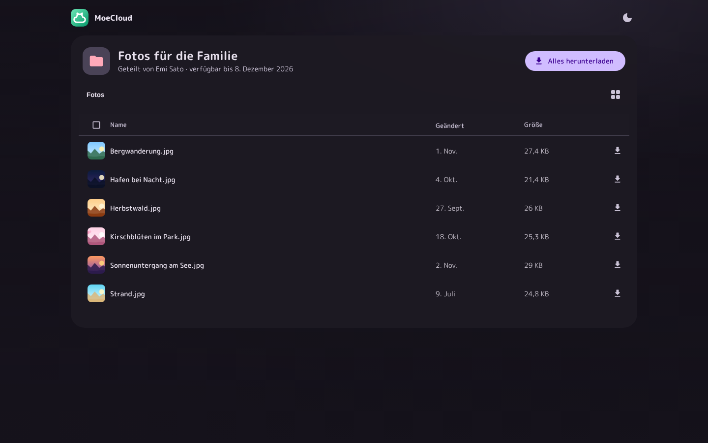
</p>

## Kommentare, Aktivität und Benachrichtigungen

- **Kommentare**: Im Detailbereich unter **Kommentare** schreiben alle, die Zugriff haben, an Dateien und Ordner. Alle anderen mit Zugriff und alle, die dort schon kommentiert haben, bekommen eine Benachrichtigung.
- **Aktivität**: Der Reiter **Aktivität** zeigt für jede Datei und jeden Ordner, wer etwas hochgeladen, bearbeitet, umbenannt, verschoben, kopiert, geteilt, kommentiert oder gelöscht hat. Unter **Zuletzt › Aktivität** steht alles aus deinen Ordnern, nach Tagen sortiert.
- **Benachrichtigungen**: Die Glocke oben rechts sammelt neue Freigaben, Kommentare, Uploads über deine Links und Hinweise zu deinem Speicher, Admins sehen dort auch Meldungen zum System. Unter **Konto › E-Mail-Benachrichtigungen** wählt jede Person, was zusätzlich per E-Mail kommt.

<p align="center">
  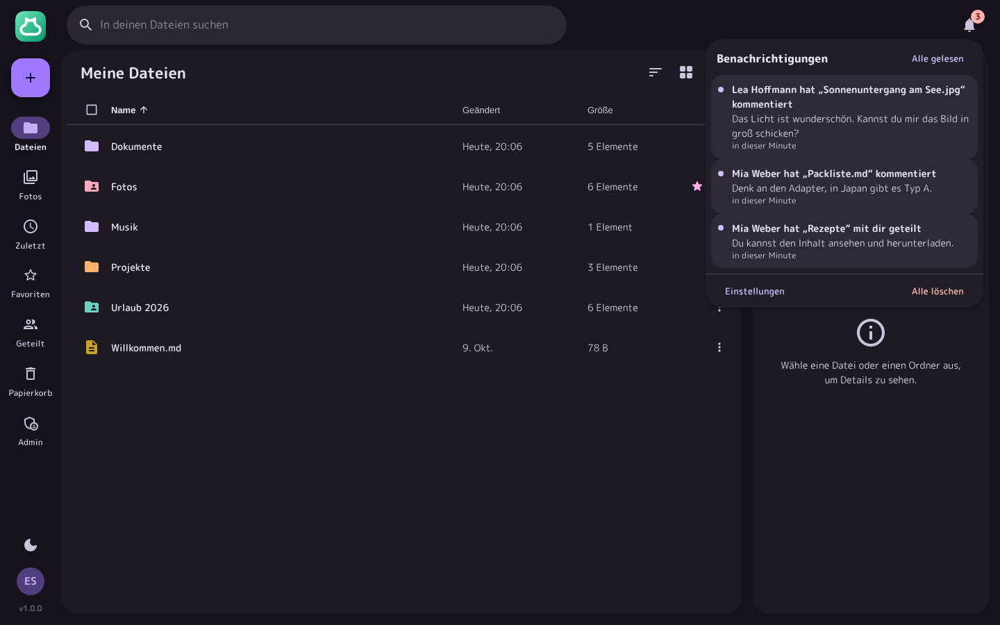
</p>

## Als Laufwerk einbinden

MoeCloud spricht WebDAV unter `https://cloud.example.com/dav/`. Die Adresse steht auch unter **Konto › WebDAV und App-Passwörter**. Dort legst du für jedes Gerät ein eigenes App-Passwort an und meldest dich damit und mit deinem Benutzernamen an. Dein normales Passwort funktioniert hier nicht, so kannst du einzelne Geräte später wieder abmelden.

- **Windows**: Im Explorer unter **Dieser PC › Netzlaufwerk verbinden** die Adresse eintragen. Windows verlangt dafür HTTPS.
- **macOS**: Im Finder **Gehe zu › Mit Server verbinden** (⌘K) und die Adresse eintragen.
- **Linux**: Im Dateimanager `davs://cloud.example.com/dav/` öffnen oder mit `davfs2` einhängen.
- **rclone**:

```bash
rclone config create moecloud webdav url=https://cloud.example.com/dav/ vendor=other user=emi pass=APP-PASSWORT --obscure
rclone sync ~/Bilder moecloud:Fotos
rclone mount moecloud: ~/MoeCloud --vfs-cache-mode writes
```

Per WebDAV siehst du deine eigenen Dateien, nicht was andere mit dir teilen. Gelöschtes landet auch hier im Papierkorb, und ist der Virenscan an, prüft MoeCloud auch hier jede Datei. Sperren bestätigt MoeCloud nur, damit Programme wie Office speichern können, vor gleichzeitigem Bearbeiten schützt das nicht.

## Konto und Sicherheit

Dein Konto öffnest du über dein Bild unten links und **Konto und Sicherheit**, auf dem Handy über **Ich**.

<p align="center">
  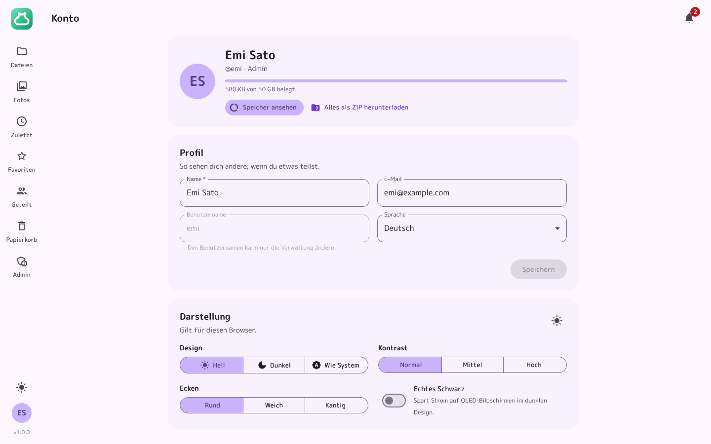
</p>

- **Profil**: Name, E-Mail und Sprache. Den Benutzernamen ändert ein Admin.
- **Speicher**: belegter Platz, ein Link zur Speicheransicht und alle eigenen Dateien als ZIP.
- **Darstellung**: Hell, Dunkel oder wie das System, 3 Stufen Kontrast, runde, weiche oder kantige Ecken und echtes Schwarz für OLED-Bildschirme. Das gilt pro Browser.
- **E-Mail-Benachrichtigungen**: für Freigaben, Uploads über Links, Kommentare und bei Admins für Meldungen zum System.
- **Passwort**: Ändern meldet alle anderen Geräte ab. Ist der E-Mail-Versand eingerichtet, gibt es auf der Anmeldeseite „Passwort vergessen“.
- **Authenticator-App**: Einrichten per QR-Code, dazu 10 Wiederherstellungscodes für den Fall, dass das Handy fehlt.
- **Passkeys**: Anmelden mit Fingerabdruck, Gesicht oder Sicherheitsschlüssel, ganz ohne Passwort.
- **WebDAV und App-Passwörter**: siehe [Als Laufwerk einbinden](#als-laufwerk-einbinden).
- **Sitzungen**: alle angemeldeten Browser mit Gerät und letzter Aktivität, einzeln oder alle anderen abmelden.
- **Sicherheitsprotokoll**: Anmeldungen, fehlgeschlagene Versuche und Änderungen an deinem Zugang.

So geht MoeCloud mit deinen Daten um:

- Passwörter speichert MoeCloud nur als Argon2id-Hash, App-Passwörter und Wiederherstellungscodes nur als HMAC, Links zum Zurücksetzen nur als SHA-256-Hash.
- Fehlversuche bei der Anmeldung sind pro Adresse und pro Konto begrenzt, bei WebDAV auf 20 in 10 Minuten. „Passwort vergessen“ verrät nicht, ob es ein Konto gibt.
- IP-Adressen speichert MoeCloud nur gekürzt, bei IPv4 ohne die letzte Stelle, bei IPv6 nur die ersten 48 Bit.
- Seiten laufen mit einer strengen Content Security Policy und Schutz gegen Anfragen von fremden Seiten. Hochgeladene Dateien liefert MoeCloud so aus, dass sie im Browser keinen Code ausführen können.
- Deine Dateien liegen unverschlüsselt im Datenordner. Wer Zugriff auf den Server oder eine Sicherung hat, kann sie lesen. Eine Ende-zu-Ende-Verschlüsselung gibt es nicht.

## Verwaltung

Admins finden unter **Admin** diese Bereiche:

| Bereich           | Inhalt                                                                                                                                                                                                                                                                                                                 |
| ----------------- | ---------------------------------------------------------------------------------------------------------------------------------------------------------------------------------------------------------------------------------------------------------------------------------------------------------------------- |
| **Übersicht**     | Personen, Dateien, belegter und freier Speicher, was das Zusammenlegen gleicher Dateien spart, Speicher nach Art, wer am meisten belegt und der Zustand von E-Mail, Virenscan, Sicherungen, Verarbeitung und Anmeldungen. **Jetzt aufräumen** leert abgelaufene Papierkörbe, alte Uploads und verwaiste Dateien sofort |
| **Personen**      | Konten anlegen, auf Wunsch mit Link per E-Mail statt Passwort, Name, E-Mail, Rolle und Speicher ändern, ein neues Passwort setzen oder einen Link zum Zurücksetzen schicken, sperren, Authenticator-App zurücksetzen, überall abmelden, löschen                                                                        |
| **Einladungen**   | Links, mit denen sich eine Person selbst ein Konto anlegt, auf Wunsch gleich per E-Mail verschickt. Jeder Link funktioniert einmal, gilt 1 bis 90 Tage und kann einen eigenen Speicher mitbringen, auch wenn die Registrierung geschlossen ist                                                                         |
| **Links**         | Alle öffentlichen Links aller Personen, mit Suche und zum Entfernen                                                                                                                                                                                                                                                    |
| **Protokoll**     | Anmeldungen, fehlgeschlagene Versuche, Änderungen der Verwaltung und Funde des Virenscans, filterbar nach Bereich und Person                                                                                                                                                                                           |
| **Virenscan**     | Verbindung zu ClamAV, Prüfung vorhandener Dateien und gesperrte Dateien, siehe [Virenscan mit ClamAV](#virenscan-mit-clamav)                                                                                                                                                                                           |
| **E-Mail**        | SMTP-Server und Test-E-Mail, siehe [E-Mail](#e-mail)                                                                                                                                                                                                                                                                   |
| **Webhooks**      | Meldungen an Discord, Slack, Matrix, Telegram, ntfy und eigene Empfänger, siehe [Webhooks](#webhooks)                                                                                                                                                                                                                  |
| **Sicherungen**   | Sicherungen der Datenbank anlegen, herunterladen und löschen, Zeitplan, siehe [Datensicherung](#datensicherung)                                                                                                                                                                                                        |
| **Einstellungen** | Siehe [Einstellungen und Umgebungsvariablen](#einstellungen-und-umgebungsvariablen), dazu Hinweise für alle und der Wartungsmodus                                                                                                                                                                                      |
| **System**        | Version und Update-Befehl, gefundene Programme für Vorschauen, Warteschlange und Suchindex, Metriken                                                                                                                                                                                                                   |

Beim Löschen einer Person überträgt MoeCloud ihre Dateien auf Wunsch an eine andere Person, sie landen dort im Ordner „Von …“. Den letzten Admin lässt MoeCloud nicht löschen oder herabstufen.

**Hinweise für alle** erscheinen oben auf jeder Seite, als Information oder Warnung und auf Wunsch bis zu einem Datum. Jede Person kann sie ausblenden. **Im Wartungsmodus** kommen nur Admins hinein, alle anderen sehen eine Wartungsseite mit deiner Nachricht, und Links und WebDAV sind gesperrt.

<p align="center">
  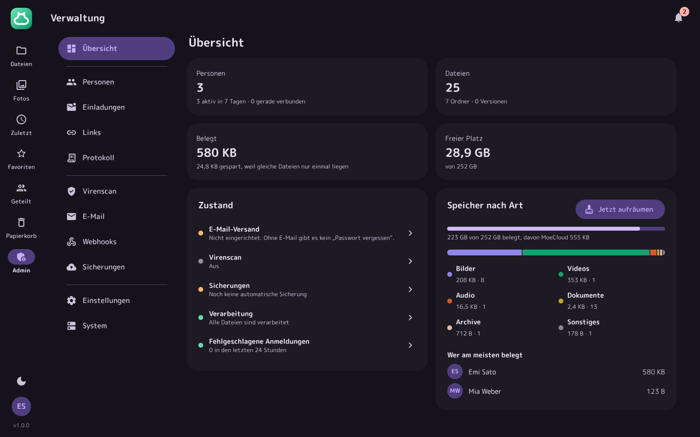
</p>

## Virenscan mit ClamAV

Mit [ClamAV](https://www.clamav.net) prüft MoeCloud jede Datei, bevor sie gespeichert wird: Uploads aus dem Browser, über Links zum Hochladen, per WebDAV und über die API, auch neue Fassungen einer Datei. Findet ClamAV Schadsoftware, wird die Datei verworfen und die Anfrage bekommt den Status 422 mit dem Namen des Funds. Das [Protokoll](#verwaltung) vermerkt den Fund, Admins bekommen eine Benachrichtigung.

MoeCloud spricht mit einem laufenden ClamAV-Dienst (`clamd`) über TCP oder einen Unix-Socket. Mit Docker startet die Ergänzung `docker/clamav.yml` ihn als eigenen Container, siehe [ClamAV dazunehmen](#clamav-dazunehmen). Ohne Docker installierst du ClamAV über die Paketverwaltung, unter Debian und Ubuntu etwa mit `apt install clamav-daemon`, und trägst den Socket `/run/clamav/clamd.ctl` ein.

<p align="center">
  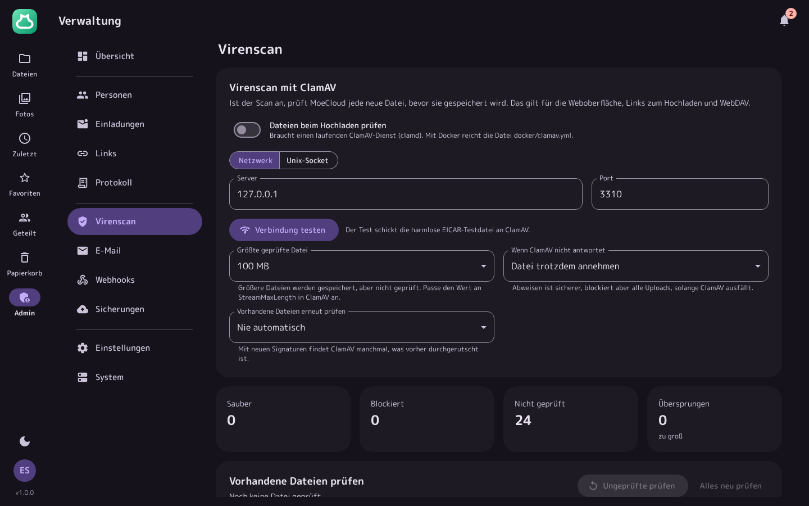
</p>

Unter **Admin › Virenscan** trägst du Server und Port ein (im Docker-Stack `clamav` und `3310`, mit `CLAMAV_HOST` schon vorbelegt) oder den Socket und prüfst die Verbindung mit „Verbindung testen“. Dabei geht die harmlose EICAR-Testdatei an ClamAV, die es erkennen muss. Außerdem legst du fest:

- **Größte geprüfte Datei**: Größere Dateien nimmt MoeCloud ungeprüft an (Standard 100 MB, auf Wunsch ohne Grenze). Soll ClamAV mehr prüfen, erhöhst du auch `StreamMaxLength` in der `clamd.conf`.
- **Wenn ClamAV nicht antwortet**: die Datei trotzdem annehmen (Standard) oder den Upload abweisen. Abweisen ist sicherer, blockiert aber alle Uploads, solange ClamAV ausfällt.
- **Vorhandene Dateien erneut prüfen**: nie automatisch (Standard), täglich oder alle 7, 14, 30 oder 90 Tage. Mit neuen Signaturen findet ClamAV manchmal, was vorher durchgerutscht ist.

Findet eine spätere Prüfung etwas, sperrt MoeCloud die Datei bei allen, die sie haben: Öffnen, Herunterladen, Teilen und WebDAV gehen nicht mehr, im Ordner steht sie mit dem Hinweis „Schadsoftware“. Unter **Gesperrte Dateien** entscheidest du, ob sie endgültig gelöscht oder bei einem Fehlalarm wieder freigegeben wird. „Ungeprüfte prüfen“ und „Alles neu prüfen“ starten eine Prüfung von Hand, auf der Kommandozeile geht das mit `scan`.

## E-Mail

Unter **Admin › E-Mail** richtest du den Versand über einen SMTP-Server ein: Server, Port, Verschlüsselung (STARTTLS, TLS oder keine), Benutzername, Passwort, Absenderadresse und Absendername. „Test senden“ schickt eine Test-E-Mail. Startwerte kannst du auch über die Variablen `SMTP_HOST`, `SMTP_PORT`, `SMTP_SECURITY` (`starttls`, `tls` oder `none`), `SMTP_USER`, `SMTP_PASSWORD`, `SMTP_FROM` und `SMTP_FROM_NAME` setzen. Sind `SMTP_HOST` und `SMTP_FROM` gesetzt, ist der Versand gleich eingeschaltet. Was du im Browser speicherst, hat Vorrang.

Darüber verschickt MoeCloud:

- **Passwort vergessen**: einen Link, der eine Stunde gilt und einmal funktioniert. Admins schicken ihn unter **Admin › Personen** auch selbst, etwa für neue Konten, dann gilt er 24 Stunden.
- **Einladungen**: Mit einer E-Mail-Adresse geht der Einladungslink gleich an die Person.
- **Benachrichtigungen**: Freigaben, Uploads über Links und Kommentare, so wie jede Person es unter **Konto** eingestellt hat. Admins bekommen auf Wunsch Meldungen zu neuen Konten, Schadsoftware, Störungen des Virenscans, fehlgeschlagenen Sicherungen, knappem Speicherplatz, vielen fehlgeschlagenen Anmeldungen und neuen Versionen.

## Webhooks

Unter **Admin › Webhooks** schickt MoeCloud wichtige Ereignisse an andere Dienste: **Discord**, **Slack**, **Matrix**, **Telegram**, **ntfy** und eigene Empfänger per JSON. Für jedes Ziel wählst du die Ereignisse:

| Ereignis                          | Wann                                                       |
| --------------------------------- | ---------------------------------------------------------- |
| Neue Konten                       | Jemand hat sich registriert                                |
| Schadsoftware gefunden            | Der Virenscan hat eine Datei abgewiesen oder gesperrt      |
| Virenscan gestört                 | ClamAV antwortet nicht                                     |
| Sicherung fehlgeschlagen          | Die nächtliche Sicherung hat nicht geklappt                |
| Wenig Speicherplatz               | Auf der Platte wird der Platz knapp                        |
| Neue Version                      | Die [Versionsprüfung](#versionsprüfung) hat etwas gefunden |
| Viele fehlgeschlagene Anmeldungen | Mindestens 25 Fehlversuche in 15 Minuten                   |

Eigene Empfänger bekommen ein JSON mit `event`, `level` (`info` oder `error`), `title`, `text`, `site` und `at`. Mit einem Geheimnis trägt jede Anfrage den Header `X-MoeCloud-Signature` mit `sha256=` und einer HMAC-SHA256-Signatur des Inhalts. „Testnachricht senden“ prüft ein Ziel, die Liste zeigt, wann zuletzt etwas zugestellt wurde oder warum es nicht geklappt hat.

## Einstellungen und Umgebungsvariablen

Alle Einstellungen stehen in der Datenbank und werden unter **Admin › Einstellungen** geändert. Sie gelten sofort.

| Bereich                  | Einstellungen                                                                                     |
| ------------------------ | ------------------------------------------------------------------------------------------------- |
| Allgemein                | Name der Cloud, Adresse, Standardsprache                                                          |
| Hinweis für alle         | Text, Art und wie lange er erscheint                                                              |
| Wartungsmodus            | An oder aus, dazu die Nachricht auf der Wartungsseite                                             |
| Aussehen                 | Grundfarbe für alle                                                                               |
| Anmeldung                | Wer sich registrieren darf (nur Admins, mit Einladungslink, alle), Passkeys                       |
| Speicher                 | Speicher pro Person, größte Datei, Frist für den Papierkorb, Versionen pro Datei, Suche im Inhalt |
| Teilen                   | Öffentliche Links, Passwort für Links, längste Gültigkeit, Teilen mit Personen, Personen finden   |
| Aufbewahrung und Updates | Wie lange Protokoll und Aktivität bleiben, Versionsprüfung                                        |
| Rechtliches              | Impressum und Datenschutz, als Adresse einer anderen Seite oder als Text                          |

Umgebungsvariablen brauchst du nur für den Betrieb. Mit Docker trägst du sie in eine `.env` neben der `docker-compose.yml` ein, ohne Docker setzt du sie beim Start:

| Variable                                                                                               | Standard                                      | Bedeutung                                                                                                                               |
| ------------------------------------------------------------------------------------------------------ | --------------------------------------------- | --------------------------------------------------------------------------------------------------------------------------------------- |
| `PORT`                                                                                                 | `3000`                                        | Port, auf dem MoeCloud lauscht                                                                                                          |
| `HOST`                                                                                                 | `0.0.0.0`                                     | Adresse, auf der MoeCloud lauscht                                                                                                       |
| `DATA_DIR`                                                                                             | `data/` im Projekt, im Container `/data`      | Ordner für Datenbank und Dateien                                                                                                        |
| `PUBLIC_URL`                                                                                           |                                               | Vorgabe für die Adresse im Einrichtungslink und im Assistenten, solange MoeCloud noch nicht eingerichtet ist                            |
| `TRUST_PROXY`                                                                                          | `loopback,linklocal,uniquelocal`              | Welchen Proxys MoeCloud `X-Forwarded-*` glaubt: `true` für alle, `false` für keinen, sonst Adressen oder Netze durch Kommas getrennt    |
| `LOG_LEVEL`                                                                                            | `info`                                        | `debug`, `info`, `warn` oder `error`                                                                                                    |
| `LOG_FORMAT`                                                                                           | `pretty`                                      | `pretty` für die Konsole, `json` für Loki, Graylog und Co.                                                                              |
| `TZ`                                                                                                   | Systemzeit, mit Docker `Europe/Berlin`        | Zeitzone für Log und nächtliche Sicherung                                                                                               |
| `CLAMAV_HOST` / `CLAMAV_PORT` / `CLAMAV_SOCKET`                                                        | Port `3310`                                   | Vorgabe für die Verbindung zu ClamAV. Ist `CLAMAV_HOST` oder `CLAMAV_SOCKET` gesetzt, ist der Virenscan von Anfang an eingeschaltet     |
| `SMTP_HOST`, `SMTP_PORT`, `SMTP_SECURITY`, `SMTP_USER`, `SMTP_PASSWORD`, `SMTP_FROM`, `SMTP_FROM_NAME` | Port `587` mit `starttls`                     | Vorgaben für den E-Mail-Versand, siehe [E-Mail](#e-mail)                                                                                |
| `METRICS_TOKEN`                                                                                        |                                               | Token für `/metrics`, siehe [Metriken für Prometheus](#metriken-für-prometheus)                                                         |
| `UPDATE_CHECK_URL`                                                                                     | `https://moecloud.moestudio.net/version.json` | Adresse für die [Versionsprüfung](#versionsprüfung), mit `off` fest aus                                                                 |
| `FFMPEG_PATH`, `FFPROBE_PATH`, `PDFTOPPM_PATH`, `PDFTOTEXT_PATH`                                       | Suche im `PATH`                               | Pfade zu den Programmen für Vorschauen                                                                                                  |
| `MOECLOUD_INSTALL`                                                                                     | `node`, im Docker-Image `docker`              | Wie MoeCloud installiert ist, damit die Verwaltung den passenden Befehl zum Aktualisieren zeigt. Das Installationsskript setzt `script` |
| `PUID` / `PGID`                                                                                        | `1000`                                        | Nur Docker: Benutzer und Gruppe, denen `data/` gehört                                                                                   |
| `MOECLOUD_BIND` / `MOECLOUD_PORT`                                                                      | `0.0.0.0` / `3000`                            | Nur Docker: Adresse und Port auf dem Host                                                                                               |
| `DOMAIN`                                                                                               |                                               | Nur Docker mit Caddy, siehe [Mit eigener Domain und HTTPS](#mit-eigener-domain-und-https)                                               |
| `VITE_DEV_SERVER`                                                                                      |                                               | Nur für die Entwicklung, siehe [Entwicklung](#entwicklung)                                                                              |

## Metriken für Prometheus

Unter `/metrics` liefert MoeCloud Zahlen im Format von Prometheus: Konten, Dateien, Ordner, Speicher, Links, Freigaben, Sitzungen, offene Uploads, Live-Verbindungen, die Warteschlange der Verarbeitung, Ergebnisse des Virenscans und fehlgeschlagene Anmeldungen. Der Zugriff braucht ein Token, das du unter **Admin › System › Metriken für Prometheus** erzeugst oder mit `METRICS_TOKEN` festlegst. Ohne Token antwortet `/metrics` mit 404.

```yaml
- job_name: moecloud
  scheme: https
  metrics_path: /metrics
  authorization:
    credentials: DEIN-TOKEN
  static_configs:
    - targets: ['cloud.example.com']
```

## Versionsprüfung

Einmal am Tag fragt MoeCloud unter `https://moecloud.moestudio.net/version.json` nach, ob es eine neue Version gibt. Abgerufen wird nur diese Datei, ohne Angaben über deinen Server oder die installierte Version. Gibt es eine neue Version, sehen Admins einen Hinweis in der Übersicht und unter **Admin › System**, mit den wichtigsten Neuerungen und dem passenden Befehl zum Aktualisieren. Einmal pro Version kommt außerdem eine Benachrichtigung, und die [Webhooks](#webhooks) für neue Versionen melden sich. Sicherheitsupdates sind als solche markiert.

Abschalten lässt sich die Prüfung unter **Admin › Einstellungen › Aufbewahrung und Updates**. Mit `UPDATE_CHECK_URL=off` ist sie fest aus, mit einer eigenen Adresse fragt MoeCloud dort nach, etwa für einen Fork. Die Datei sieht so aus, Pflicht ist nur `version`, `changelog` muss mit `https://` beginnen und von `notes` zeigt MoeCloud höchstens 10 Punkte pro Sprache:

```json
{
  "version": "1.0.0",
  "date": "2026-11-08",
  "changelog": "https://moecloud.moestudio.net/changelog.html#v1.0.0",
  "security": false,
  "notes": {
    "de": ["Virenscan mit ClamAV für alle Uploads"],
    "en": ["Virus scanning with ClamAV for every upload"]
  }
}
```

## Updates

Was neu ist und worauf du achten musst, steht im [Changelog](CHANGELOG.md).

- **Mit dem Installationsskript**: `sudo moecloud update`
- **Mit Docker**: `docker compose pull` und `docker compose up -d`
- **Mit Node.js**: `git pull`, `npm ci`, `npm run build` und MoeCloud neu starten

Ändert sich mit einem Update die Datenbank, sichert MoeCloud sie beim ersten Start als `moecloud-update-…db` in `data/backups/` und bringt sie danach auf den neuen Stand. Beim Update von 0.1.0 auf 1.0.0 kommen die Tabellen für Protokoll, Aktivität, Benachrichtigungen, Kommentare, Webhooks und den Suchindex dazu. Vorhandene Dateien liest MoeCloud danach im Hintergrund für Vorschaubilder, Fotos und Suche ein, das läuft nebenher und braucht nichts von dir. Den Fortschritt siehst du unter **Admin › System**.

Für den Virenscan startest du danach ClamAV und schaltest ihn unter **Admin › Virenscan** ein, für E-Mails richtest du den Versand unter **Admin › E-Mail** ein. Wer mit Docker installiert hat, bekommt mit dem neuen Image auch ffmpeg und Poppler.

## Datensicherung

Alles, was MoeCloud speichert, liegt in einem Ordner:

```
data/
  moecloud.db      Datenbank mit Konten, Ordnern, Freigaben und Einstellungen
  moecloud.db-wal  Änderungen, die noch nicht in der Datenbank stehen
  blobs/           die Dateien, benannt nach ihrer Prüfsumme
  thumbs/          Vorschaubilder, MoeCloud erzeugt sie bei Bedarf neu
  tmp/             laufende Uploads
  backups/         Sicherungen der Datenbank
```

Die Datenbank sichert MoeCloud jede Nacht um 3 Uhr als `moecloud-auto-…db` und behält die letzten 7 automatischen Sicherungen. Uhrzeit und Anzahl stellst du unter **Admin › Sicherungen** ein, dort startest du auch eine Sicherung von Hand und lädst sie herunter. Auf der Kommandozeile geht das mit `backup`, die Sicherung landet dann als `moecloud-manual-20261108-101509.db` in `data/backups/`:

```bash
docker compose exec moecloud moecloud backup
```

Die Dateien selbst stecken nicht in diesen Sicherungen. Sichere den Ordner `data/blobs/` zusätzlich, etwa mit `restic`, Borg oder `rsync`. Zum Zurückspielen MoeCloud beenden, die Sicherung als `data/moecloud.db` ablegen, `moecloud.db-wal` und `moecloud.db-shm` löschen, `blobs/` zurückkopieren und MoeCloud wieder starten. `check` zeigt danach, ob alle Dateien da sind.

Die Datenbank enthält Passwort-Hashes, die Schlüssel der Authenticator-Apps, das Passwort für den SMTP-Server und den Schlüssel, mit dem MoeCloud App-Passwörter prüft. Bewahre Sicherungen so sicher auf wie den Server selbst.

## Kommandozeile

| Befehl                                   | Zweck                                                                                               |
| ---------------------------------------- | --------------------------------------------------------------------------------------------------- |
| `users`                                  | Alle Konten mit belegtem Speicher anzeigen                                                          |
| `create-admin <name> [--email] [--name]` | Admin-Konto mit neuem Passwort anlegen, etwa wenn du die Einrichtung im Browser überspringen willst |
| `reset-password <name>`                  | Neues Passwort setzen und alle Sitzungen beenden                                                    |
| `reset-2fa <name>`                       | Authenticator-App eines Kontos entfernen, Passkeys bleiben                                          |
| `setup-link [--new]`                     | Link für die Einrichtung anzeigen, mit `--new` einen neuen Code erzeugen                            |
| `backup [ordner]`                        | Datenbank sichern, ohne den Server anzuhalten                                                       |
| `cleanup`                                | Papierkorb, alte Uploads und verwaiste Dateien aufräumen                                            |
| `check`                                  | Prüfen, ob alle Dateien auf der Platte liegen                                                       |
| `maintenance <on\|off> [text]`           | Wartungsmodus ein- oder ausschalten                                                                 |
| `scan-test`                              | Verbindung zu ClamAV mit der EICAR-Testdatei prüfen                                                 |
| `scan [--all]`                           | Ungeprüfte Dateien mit ClamAV prüfen, mit `--all` alle                                              |
| `mail-test <adresse>`                    | Test-E-Mail schicken                                                                                |
| `process`                                | Vorschaubilder, Bildinfos und Suchindex nachholen                                                   |
| `reindex`                                | Suchindex für Inhalte neu aufbauen                                                                  |
| `version`                                | Installierte und neueste Version anzeigen                                                           |

Mit Docker heißen die Befehle `docker compose exec moecloud moecloud users`, `… moecloud reset-password emi` und so weiter, nach dem Installationsskript `sudo moecloud users`. Sie laufen dort mit dem Benutzer, dem `data/` gehört. Ohne Docker nimmst du `npm run cli -- users`. Legst du das erste Konto mit `create-admin` an, starte MoeCloud danach einmal neu.

## API

Die Weboberfläche nutzt dieselbe API wie deine Skripte. Skripte melden sich mit dem Benutzernamen und einem App-Passwort per HTTP Basic an, das klappt für alle Pfade unter `/api/`. Antworten kommen als JSON, Fehler als `{ "error": { "code", "message" } }`.

```bash
curl -u emi:APP-PASSWORT https://cloud.example.com/api/session
curl -u emi:APP-PASSWORT -F "file=@rechnung.pdf" https://cloud.example.com/api/nodes/ORDNER-ID/upload
```

| Methode | Pfad                                                          | Beschreibung                                                                                                                                          |
| ------- | ------------------------------------------------------------- | ----------------------------------------------------------------------------------------------------------------------------------------------------- |
| `GET`   | `/api/session`                                                | Angemeldete Person, `user.rootId` ist die ID deines Hauptordners                                                                                      |
| `GET`   | `/api/nodes/:id`                                              | Ein Element mit Pfad                                                                                                                                  |
| `GET`   | `/api/nodes/:id/children`                                     | Inhalt eines Ordners, mit `?folders=1` nur die Unterordner                                                                                            |
| `POST`  | `/api/nodes/:id/folders`                                      | Ordner anlegen, JSON `{ "name" }`                                                                                                                     |
| `POST`  | `/api/nodes/:id/upload`                                       | Dateien als `multipart/form-data` hochladen, mit `?conflict=replace` vorhandene ersetzen                                                              |
| `GET`   | `/api/nodes/:id/content`                                      | Datei herunterladen, auch in Teilen per `Range`                                                                                                       |
| `PUT`   | `/api/nodes/:id/content`                                      | Inhalt einer Datei als `application/octet-stream` ersetzen, die alte Fassung wird zur Version                                                         |
| `GET`   | `/api/nodes/:id/meta`                                         | Abmessungen, Aufnahmedatum, Bildinfos, Musik-Tags und Ergebnis des Virenscans                                                                         |
| `PATCH` | `/api/nodes/:id`                                              | Umbenennen, JSON `{ "name" }`                                                                                                                         |
| `PUT`   | `/api/nodes/color`                                            | Ordner einfärben, JSON `{ "ids": [], "color" }` mit `red`, `orange`, `yellow`, `green`, `teal`, `blue`, `purple`, `pink`, `brown`, `gray` oder `null` |
| `POST`  | `/api/nodes/move`, `/api/nodes/copy`                          | Verschieben oder kopieren, JSON `{ "ids": [], "target" }`                                                                                             |
| `POST`  | `/api/nodes/trash`, `/api/nodes/restore`, `/api/nodes/delete` | In den Papierkorb, zurückholen oder endgültig löschen, JSON `{ "ids": [] }`                                                                           |
| `GET`   | `/api/search?q=&kind=`                                        | Suche nach Namen und im Inhalt, `kind` ist `folder`, `image`, `video`, `audio`, `pdf` oder `document`                                                 |
| `GET`   | `/api/recent`, `/api/starred`, `/api/trash`                   | Zuletzt, Favoriten und Papierkorb                                                                                                                     |
| `GET`   | `/api/photos`                                                 | Fotos und Videos nach Aufnahmedatum, weitere Seiten mit `?at=&seq=` aus `next`                                                                        |
| `GET`   | `/api/activity`, `/api/nodes/:id/activity`                    | Aktivität in deinen Ordnern oder an einem Element, ältere mit `?before=`                                                                              |
| `GET`   | `/api/nodes/:id/comments`                                     | Kommentare, `POST` mit JSON `{ "text" }` schreibt einen neuen                                                                                         |
| `GET`   | `/api/nodes/:id/archive`                                      | Inhalt eines ZIP-Archivs, eine einzelne Datei daraus mit `/archive/entry?path=`                                                                       |
| `GET`   | `/api/nodes/:id/versions`                                     | Ältere Fassungen einer Datei                                                                                                                          |
| `GET`   | `/api/zip?ids=`                                               | Elemente als ZIP, IDs durch Kommas getrennt                                                                                                           |
| `POST`  | `/api/nodes/:id/links`                                        | Öffentlichen Link anlegen, JSON mit `label`, `password`, `expiresAt`, `allowDownload`, `allowUpload`, `uploadOnly`, `notify`                          |
| `GET`   | `/api/shared`                                                 | Was mit dir geteilt ist und was du teilst                                                                                                             |
| `GET`   | `/api/storage`, `/api/storage/report`                         | Belegter Speicher und Grenze, dazu die Aufteilung nach Art, die größten und die doppelten Dateien                                                     |
| `GET`   | `/api/notifications`                                          | Benachrichtigungen, `POST /api/notifications/read` markiert sie als gelesen                                                                           |
| `GET`   | `/api/events`                                                 | Änderungen live als Server-Sent Events                                                                                                                |

Öffentlich erreichbar sind `/s/:token` (geteilte Links), `/dav/` (WebDAV), `/forgot` und `/reset` (Passwort vergessen), `/impressum`, `/datenschutz`, `/metrics` mit Token und `/healthz` für Health-Checks.

### Große Dateien über die API

Große Dateien gehen in Teilen hoch, so lässt sich ein abgebrochener Upload fortsetzen:

1. `POST /api/uploads` mit JSON `{ "parentId", "name", "size" }` beginnt den Upload. Optional sind `modifiedAt` in Millisekunden, `relativePath` für Unterordner und `conflict` mit `rename` oder `replace`. Die Antwort enthält die `id` und die Größe der Teile in `chunkSize` (16 MB).
2. `PUT /api/uploads/:id?offset=…` schickt das nächste Teil als `application/octet-stream`. `offset` ist die Zahl der Bytes, die schon angekommen sind, die Antwort nennt den neuen Stand in `received`. Passt der Offset nicht, antwortet MoeCloud mit 409 und dem richtigen Stand in `error.received`.
3. `POST /api/uploads/:id/complete` schließt den Upload ab, prüft die Datei mit dem Virenscan und gibt die neue Datei in `node` zurück. Enthält sie Schadsoftware, kommt 422 mit dem Code `infected`.

`GET /api/uploads/:id` zeigt den Stand nach einem Abbruch, `DELETE /api/uploads/:id` verwirft den Upload. Unfertige Uploads verfallen nach 24 Stunden ohne neues Teil.

```bash
DATEI=video.mp4
GROESSE=$(stat -c %s "$DATEI")
ORDNER=$(curl -s -u emi:APP-PASSWORT https://cloud.example.com/api/session | jq -r .user.rootId)
ID=$(curl -s -u emi:APP-PASSWORT -H "Content-Type: application/json" \
  -d "{\"parentId\":\"$ORDNER\",\"name\":\"$DATEI\",\"size\":$GROESSE}" https://cloud.example.com/api/uploads | jq -r .id)
OFFSET=0
while [ "$OFFSET" -lt "$GROESSE" ]; do
  OFFSET=$(tail -c +$((OFFSET + 1)) "$DATEI" | head -c 16777216 | curl -s -X PUT -u emi:APP-PASSWORT \
    -H "Content-Type: application/octet-stream" --data-binary @- \
    "https://cloud.example.com/api/uploads/$ID?offset=$OFFSET" | jq -r .received)
done
curl -s -X POST -u emi:APP-PASSWORT https://cloud.example.com/api/uploads/$ID/complete
```

## Entwicklung

```bash
npm install
npm run dev:web
npm run dev
```

`npm run dev:web` startet Vite auf Port 5173, `npm run dev` startet den Server auf Port 3000 mit `VITE_DEV_SERVER=http://localhost:5173`. Änderungen an der Oberfläche erscheinen sofort, der Server startet bei Änderungen neu. Der Server läuft direkt aus TypeScript, ohne eigenen Build.

| Befehl                                | Zweck                                                                                                                                                                         |
| ------------------------------------- | ----------------------------------------------------------------------------------------------------------------------------------------------------------------------------- |
| `npm run typecheck`                   | TypeScript für Server und Oberfläche prüfen                                                                                                                                   |
| `npm test`                            | Tests für API, Anmeldung, Freigaben, WebDAV, Virenscan, E-Mail, Vorschauen und Verwaltung                                                                                     |
| `npm run build`                       | Oberfläche nach `dist/web` bauen                                                                                                                                              |
| `npm run test:browser`                | Abläufe im Browser mit Chrome prüfen und die Screenshots in `docs/screenshots` neu erzeugen. Braucht vorher `npm run build`, mit `CHROME_PATH` gibst du den Pfad zu Chrome an |
| `npm run format`                      | Code mit Prettier formatieren                                                                                                                                                 |
| `node tools/i18n.ts`                  | Prüft, ob alle Texte übersetzt sind und alle Platzhalter stimmen                                                                                                              |
| `node tools/demo.ts <adresse> [code]` | Legt Beispieldaten mit Emi, Mia und Lea an, mit Code auch gleich die Einrichtung                                                                                              |
| `node tools/icons.ts`                 | Erzeugt alle Icons aus `public/favicon.svg`                                                                                                                                   |
| `node tools/website.ts`               | Erzeugt Schriften, Bilder und Vorschaubild für die Website aus den Screenshots, braucht wie der Ablauf im Browser Chrome                                                      |
| `node tools/check-website.ts`         | Prüft Links, Anker und die `version.json` der Website                                                                                                                         |

Die Tests für den Virenscan brauchen kein ClamAV, sie sprechen mit einem nachgebauten `clamd`. E-Mails landen in den Tests in einem Postausgang im Speicher.

Die Texte sind auf Deutsch geschrieben und dienen gleichzeitig als Schlüssel für die Übersetzung. Die englischen Texte für Oberfläche und Server liegen in `src/i18n/en.json`, Platzhalter wie `{name}` bleiben gleich. Wo Einzahl und Mehrzahl im Deutschen gleich sind, im Englischen aber nicht, stehen beide Formen durch `|` getrennt, etwa `"{count} Ordner": "{count} folder|{count} folders"`.

| Ordner          | Inhalt                                                                                                                       |
| --------------- | ---------------------------------------------------------------------------------------------------------------------------- |
| `src/routes`    | Seiten und API, nach Bereichen getrennt                                                                                      |
| `src/services`  | Logik für Dateien, Uploads, Vorschauen, Virenscan, E-Mail, Benachrichtigungen, Freigaben, Anmeldung, Sicherungen und Wartung |
| `src/lib`       | Datenbank, Migrationen, ClamAV, Krypto, HTTP-Helfer, Validierung und Übersetzung                                             |
| `src/views`     | Seiten ohne JavaScript wie Anmeldung, Registrierung und Passwort vergessen, mit Preact auf dem Server                        |
| `src/i18n`      | Englische Texte                                                                                                              |
| `web/src`       | Oberfläche mit React und Material UI, nach Bereichen getrennt, die Vorschauen unter `app/files/preview`                      |
| `web/src/theme` | Farbschema aus der Grundfarbe, Tokens und MUI-Theme                                                                          |
| `docker/`       | Startskript, Kommandozeile, Caddyfile und die Ergänzung für ClamAV                                                           |
| `website/`      | Projektseite moecloud.moestudio.net mit Installationsskript und `version.json`                                               |
| `test/`         | API-Tests und der Ablauf im Browser                                                                                          |
| `tools/`        | Übersetzungen prüfen, Beispieldaten, Icons und Website                                                                       |
| `cli.ts`        | Befehle für die Kommandozeile                                                                                                |

## Support, Mitwirken und Lizenz

Fehler und Ideen gerne als [Issue](https://github.com/MaximilianGT500/moecloud/issues/new/choose) oder Pull Request, siehe [CONTRIBUTING.md](CONTRIBUTING.md). Sicherheitslücken meldest du bitte nicht öffentlich, sondern wie in [SECURITY.md](SECURITY.md) beschrieben. Kontakt gibt es auch über meine [Website](https://maxi.lol/kontakt/).

MoeCloud steht unter der [MIT-Lizenz](LICENSE).
